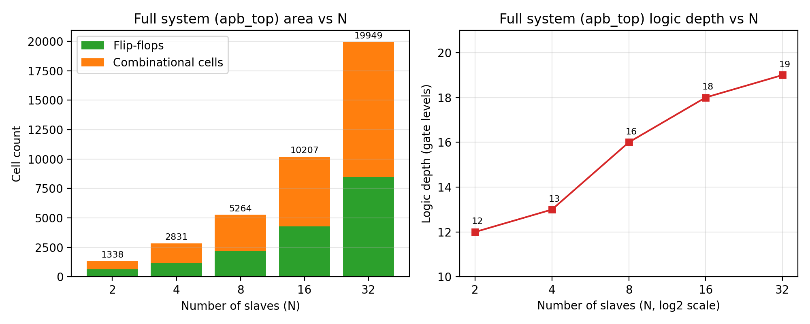
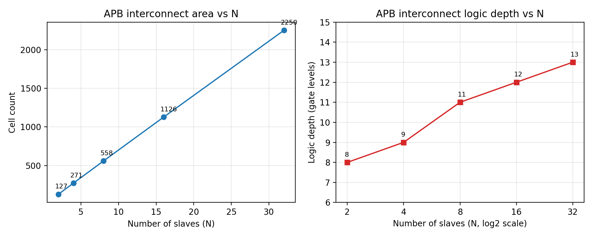
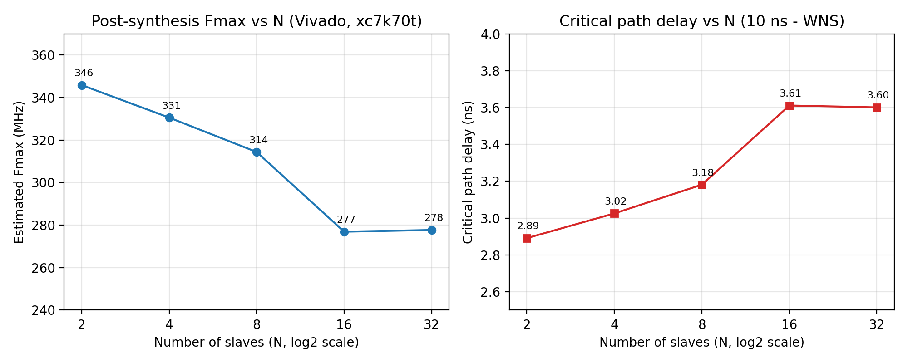

# Scalable Multi-Slave AMBA APB Bus: RTL, Verification and Yosys Synthesis

A parameterized AMBA APB bus written in Verilog (one master, an address-decoding
interconnect, N register-based slaves), verified with a self-checking testbench,
synthesized with the open-source **Yosys** flow, and analysed for how area, logic
depth and clock frequency change as the number of slaves grows from 2 to 32.

**Author:** GANDHODI KOMARAMSETTI SAI SIDDARTHA | **Guide:** K.S. KHAJA HUSSAIN | **Institution:** RGUKT IIIT RK VALLEY

## Features

- APB master FSM (IDLE, SETUP, ACCESS) with a simple `start` / `done` command interface
- Interconnect with address decoder, response multiplexer and a default responder
  that answers unmapped addresses with `PSLVERR` (the bus never hangs)
- Slaves with 8 x 32-bit registers, configurable wait states (slave *i* has *i* mod 4) and an error response for out-of-range offsets
- Fully parameterized: `N_SLAVES`, `ADDR_W`, `DATA_W`, `OFFSET_BITS`, `NUM_REGS`
- Asynchronous active-low reset

## Repository structure

```
rtl/                 Verilog source (apb_master, apb_interconnect, apb_slave, apb_top)
tb/                  Self-checking testbench (tb_apb_top.v)
synth/               Yosys and Vivado sweep scripts
apb_top_N4.v         Gate-level netlist for N = 4, used for gate-level simulation
Results_png/vivado/  Graphs and the combined results table (final_results.csv)
```

## Address map (N = 4)

| Slave | Address range | Wait states |
|---|---|---|
| 0 | 0x0000 to 0x0FFF | 0 |
| 1 | 0x1000 to 0x1FFF | 1 |
| 2 | 0x2000 to 0x2FFF | 2 |
| 3 | 0x3000 to 0x3FFF | 3 |

Registers sit at offsets 0x00 to 0x1C inside each slave. An offset of 0x20 or above gives
`PSLVERR` from the slave. An address of 0x4000 or above is unmapped and gets `PSLVERR` from the interconnect.

## Verification

The testbench has 9 test groups and **159 checks**: reset, write/read-back, full register
sweep, back-to-back transfers, wait-state timing, slave errors, unmapped addresses,
boundary addresses and reset in the middle of a transfer. It uses only top-level ports,
so the same file runs unchanged on the synthesized netlist.

Result: 159 checks, 0 errors, finish at 8690 ns, on both the RTL and the Yosys gate-level netlist.

## Results

| N | Yosys cells | Flip-flops | Logic depth | Interconnect cells | Interconnect depth | Vivado Fmax (MHz) |
|---|---|---|---|---|---|---|
| 2 | 1338 | 619 | 12 | 127 | 8 | 345.9 |
| 4 | 2831 | 1147 | 13 | 271 | 9 | 330.6 |
| 8 | 5264 | 2195 | 16 | 558 | 11 | 314.4 |
| 16 | 10207 | 4291 | 18 | 1126 | 12 | 276.9 |
| 32 | 19949 | 8483 | 19 | 2250 | 13 | 277.7 |

- The interconnect grows linearly in area (about 70 cells per slave) and roughly
  logarithmically in logic depth (8 to 13 gate levels).
- The complete system grows by about 610 cells per slave; flip-flops are about 42% of all cells.
- Estimated Fmax falls from 346 MHz (N = 2) to 278 MHz (N = 32). For N = 4 the slowest
  path is the slave write-enable decode, about 79% of it estimated routing delay.





Cell counts are in Yosys's generic gate library. Fmax is a **post-synthesis estimate**
(Vivado, device xc7k70tfbv676-1, 10 ns clock, no placement or routing), so real hardware would be slower.

## How to reproduce (Windows)

**1. RTL simulation (Vivado simulator).** Create an RTL project, add the four files in `rtl/` as design
sources and `tb/tb_apb_top.v` as the simulation source, run the behavioural simulation, then enter
`run all` in the Tcl console. Expect `Checks run : 159`, `Errors : 0`.

**2. Yosys synthesis sweep (N = 2 to 32).** In the OSS CAD Suite terminal, from the project root:
```
synth\run_synth_v2.bat
```
Netlists go to `netlist/`, reports to `reports/`, and the summary to `reports/summary.txt`.

**3. Gate-level simulation.** Create a second Vivado project with only `apb_top_N4.v`
(not the RTL files, which define the same module) as the design source and `tb/tb_apb_top.v`
as the simulation source, then `run all`.

**4. Vivado timing estimate.**
```
set VIVADO="C:\path\to\Vivado\bin\vivado.bat"
synth\run_vivado_fmax.bat
```
Results go to `Results_png/vivado/fmax.csv`.

> **Note on scripts:** `run_synth.bat` and `run_synth.sh` set N with Yosys's `chparam` command and give
> different (larger) cell counts for the same RTL. Use `run_synth_v2.bat`, which sets N in a temporary
> copy of the source, for all reported numbers.

## Limitations

- Single master; no bursts or pipelining; APB4 signals `PSTRB` and `PPROT` are not implemented
- The master is a simple requester, not an AHB or AXI bridge
- Gate-level simulation is zero-delay (functional equivalence only)
- The testbench is fixed to N = 4

## Future work

AHB/AXI-to-APB bridge, APB4 signals, a registered write-enable to reduce fanout, a standard-cell
mapping with static timing analysis (for example sky130 with OpenSTA), and a parameterized or UVM testbench.

## License

MIT. See the [LICENSE](LICENSE) file.
